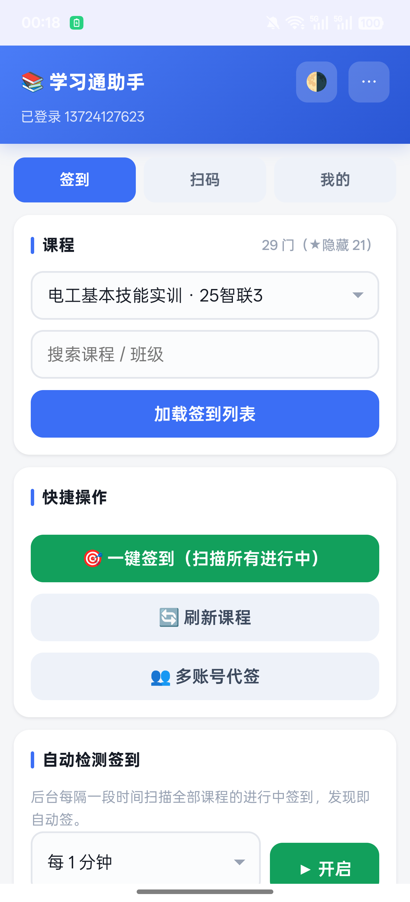

# 学习通签到助手（XXT Sign-in Helper）

> 纯本地运行的超星学习通签到辅助 App —— **直连官方接口 · 无需密钥 · 零消耗 · 无第三方服务器**
>
> 当前版本：**v3.1**（versionCode 31）· Android 5.0+（minSdk 21，targetSdk 34）· 约 218 KB



一个只有 200 多 KB 的原生壳 + H5 混合应用：原生层负责 HTTP 代理与会话 Cookie 持久化，
H5 层实现全部签到业务。所有请求直连学习通官方接口，密码与会话只保存在你自己的手机里，
**不经过任何第三方服务器**。

---

## 功能一览

| 模块 | 说明 |
|---|---|
| ✅ 一键签到 | 扫描全部课程的进行中活动，普通 / 手势 / 签到码 / 位置签到全自动 |
| ⏱ 自动检测 | 前台服务常驻，每 30 秒～10 分钟轮询一次，发现签到自动完成（息屏 / 切后台均可运行） |
| 📷 扫码签到 | 摄像头实时扫码：系统引擎 + jsQR 双引擎自动切换（无 GMS 国产 ROM 全能扫）、变焦（硬件/双指捏合）、手电筒、连续扫模式、远距离小码原生像素 ROI 识别；相册多图多区域识别；手动粘贴 |
| 🪪 人脸识别 | 一键拉取学习通学籍照存为「人脸 ID」，或上传本人照片（自动压缩）；人脸还可为二维码签到换取 enc |
| 💬 群聊签到 | 一键扫描全部群聊：普通/位置/签到码自动签，二维码类给「扫码/缓存 enc/粘贴」入口（IM 加密密码自动 DES 解密） |
| 👥 多账号代签 | 添加同学账号，一键替他们签到（v3.0 起账号间会话 / 缓存彻底隔离） |
| 🔗 分享互助 | 现场同学扫到二维码后生成分享链接 / 二维码，远程同学用 enc 直接签 |
| 📋 记录与待办 | 签到历史、enc 缓存、「缺 enc 待扫码」待办清单 |
| 🌗 深色模式 | 浅色 / 深色手动切换 |

## v3.1 更新（相对 v3.0）

**修复**
- **群聊签到从「必失败」到可用**：学习通下发的 IM 密码是 DES/ECB 加密的十六进制串，旧版直接当明文提交必然登录失败；v3.1 内置纯 JS DES+PKCS5 解密（参考 ChaoxingSignFaker），并兼容表单 / JSON / JSON+表单 Content-Type 三种 token 请求形态
- **部分机型「相册选图 / 上传人脸」点了没反应**：原生壳实现 `onShowFileChooser` 文件选择器（WebView 默认不实现，`input[type=file]` 会静默失败）；H5 侧同时把 input 挂载到 DOM 再触发（游离 input 在部分 WebView 不弹选择器）
- 全局 JS 错误捕获：页面异常直接进日志面板（右上角 ⋯），不再「点了没反应」查无对证

**扫码大幅强化**
- 变焦：支持硬件变焦的机型走摄像头 `zoom` 约束（画质最优），否则 CSS 放大 + 解码侧 ROI 裁剪同步；双指捏合缩放
- 手电筒按钮（设备支持 torch 时）
- 连续扫模式：签完不关摄像头继续扫下一个（同内容 8 秒去重）
- 远距离小码：优先申请 2560×1440 分辨率；jsQR 改为「中心区域原生像素 ROI」解码而非整帧缩小
- 引擎自愈：系统 BarcodeDetector 连续 6 帧无结果自动切换 jsQR（部分 ROM 的系统引擎对小码/远景无能）
- 相册识别：一次最多选 6 张逐张尝试；`scanImageFile` 多区域全分辨率解码（整图 → 中心 → 四象限，1400px）；`createImageBitmap` 失败自动回退 `Image` + ObjectURL

**群聊签到重做**
- 「💬 一键扫描群聊并签到」：3 路并发拉全部群消息 → 汇总去重 → 4 路并发拉活动详情 → 非二维码类直接自动签 → 结果面板汇总，二维码类逐个给「缓存 enc 直签 / 摄像头扫码 / 粘贴 enc」入口

**其他**
- 原生代理新增 `mode=3`：原样透传请求体、不自动设置 Content-Type（IM token 多形态兼容所需）
- JS console 转发 logcat（tag `xxtjs`，调试用）
- MonitorService WakeLock 策略：每轮检测持锁 2 分钟，息屏时保证 JS 跑完
- 构建脚本支持 `--vcode/--vname` 参数；群列表长文本溢出省略号

> v3.0 的完整更新记录（会话保活、统一签到核心、缓存隔离、jsQR 引入等）见 [CHANGELOG.md](CHANGELOG.md)

## 安装

1. 下载 [dist/xxt-qd-v3.1.apk](dist/xxt-qd-v3.1.apk)（或从 [Releases](https://github.com/tong174/xxt-signin-helper/releases) 安装）
2. 手机允许「安装未知来源应用」后直接安装
3. 已装 v2.5 / v3.0 的用户可直接覆盖安装（签名一致，数据保留）

## 使用指南

<details>
<summary><b>基本签到流程</b></summary>

1. 打开 App，输入学习通账号密码登录（密码只存本机，直接提交给官方接口）
2. 「签到」页选择课程 → 加载签到列表，或直接点 **🎯 一键签到**
3. 长时间挂机：打开 **自动检测签到**，选间隔后点「▶ 开启」——通知栏会出现常驻通知，息屏也能自动签
4. 教师投屏二维码：「扫码」页 → 📷 摄像头扫码，扫到立即签，并可分享给同学
</details>

<details>
<summary><b>二维码签到的三条路径</b></summary>

enc 密钥只存在于教师投屏的二维码里（10 秒一换），学生端接口拿不到。可行路径：
1. **现场同学扫到后分享**：分享链接 / 二维码发给远程同学，enc 有效期内直接签
2. **群聊签到**：一键扫描群聊里的签到卡片，非二维码类直接自动签；二维码类现场扫一次 enc 全班复用
3. **人脸换 enc**：活动开启人脸验证时，用已保存的人脸 ID 调 `check-face-result` 换取 enc（成功率取决于学校配置）
</details>

<details>
<summary><b>人脸识别</b></summary>

- 「扫码」页 → **🪪 拉取我的学籍照**：一条命令取回你在学习通的学籍照存为人脸 ID（不用拍照）
- 或 **📷 上传/拍摄本人照片**：自动压缩后上传学习通云盘换取 objectId
- 保存后所有签到自动携带 `faceImageObjectId`，并解锁「人脸换 enc」
</details>

<details>
<summary><b>多账号代签</b></summary>

「我的」页添加同学账号（密码仅存本机 localStorage）→「签到」页点 👥 多账号代签：
逐个登录 → 扫描全部课程 → 能签的全签 → 完成后自动恢复你的登录态，弹窗汇总结果。
二维码类活动仅在 enc 缓存命中时才会代签（enc 与账号无关，可以共享）。
</details>

## 工作原理

```
┌────────────────────────── App（单进程）─────────────────────────┐
│                                                                  │
│  H5 页面 (assets/index.html, https://app.local/)                 │
│    │  fetch('https://xxt.local/r?d=<base64(JSON)>')              │
│    ▼                                                             │
│  WebViewClient.shouldInterceptRequest   ← 全部请求被原生层接管    │
│    │                                                             │
│    ▼                                                             │
│  原生 HTTP 代理 (HttpURLConnection)                              │
│    · Cookie 罐持久化（SharedPreferences）                        │
│    · gzip / UA 伪装 / mode 0-3 四种请求体形态                    │
│    ▼                                                             │
│  学习通官方接口（passport2 / mooc1 / mobilelearn / easemob …）   │
│                                                                  │
│  MonitorService（前台服务）                                      │
│    · Handler 定时唤起页面 monTick()，息屏不节流                  │
│    · 每轮检测持有 PARTIAL_WAKE_LOCK（2 分钟）                    │
└──────────────────────────────────────────────────────────────────┘
```

- **绕过 CORS**：H5 不直接发跨域请求，由原生层代发，结果原样回传
- **安全上下文**：页面挂在 `https://app.local/` 下，摄像头等 API 可用
- **会话保持**：所有 Set-Cookie 进原生 Cookie 罐并持久化，每个请求自动携带
- 签到协议细节见 [docs/PROTOCOL.md](docs/PROTOCOL.md)

## 从源码构建

无需 Gradle / Android Studio，只要 JDK 17+、Python 3 和 Android SDK build-tools 34：

```bash
# 目录结构
#   app/          源码（java + assets + res + AndroidManifest.xml）
#   tools/        签名工具（keystore 不入库，首次构建自动生成）
#   dist/         产物

cd app
python build_apk.py                                # 产物: dist/xxt-qd.apk
python build_apk.py --vcode 32 --vname 3.2 -o dist/my.apk

# SDK / JDK 路径在 build_apk.py 顶部常量（SDK / JAVA_HOME），按自己环境修改
# 签名: 默认 ../tools/xxt.keystore（缺失自动生成）；--keystore/--alias/--kspass 可覆盖
```

构建流程：`aapt2 compile/link → javac → d8 → 打包 dex → zipalign → apksigner(v1+v2+v3)`，
详见 [docs/BUILD.md](docs/BUILD.md)。

## 已知限制（如实说明）

| 事情 | 原因 |
|---|---|
| 远程凭空拿 enc | enc 只在教师投屏二维码里，学生端接口不返回；本 App 提供分享/群聊/人脸三条替代路径 |
| 爆破签到码 | 服务端有失败计数锁定（连错锁 1 小时），本 App 只提交你可见的码 |
| Android 15+ 长挂机 | 系统对 dataSync 前台服务有 6h/24h 限时，超时后需手动重新开启监控 |

## 免责声明

本项目仅供学习与技术研究使用，接口协议均来自公开开源项目与自行抓包分析。
使用本工具产生的任何后果（包括但不限于账号处分）由使用者自行承担。
请遵守所在学校的相关规定，建议在教师允许的场景下使用。

## 致谢

- [cxOrz/chaoxing-signin](https://github.com/cxOrz/chaoxing-signin) — 签到协议参考
- [MetaQiu/xxtSignApi](https://github.com/MetaQiu/xxtSignApi) — API 分析文档
- ChaoxingSignFaker — 二维码 / 人脸 / IM 协议参考
- [coolsnowwind/jsQR](https://github.com/coolsnowwind/jsQR) — 内置二维码解码引擎（Apache-2.0）

## License

[Apache License 2.0](LICENSE)
