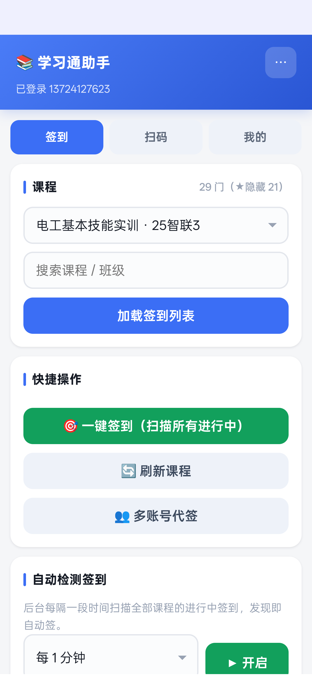

# 学习通签到助手（XXT Sign-in Helper）

> 纯本地运行的超星学习通签到辅助 App —— **直连官方接口 · 无需密钥 · 零消耗 · 无第三方服务器**
>
> 当前版本：**v3.0**（versionCode 30）· Android 5.0+（minSdk 21，targetSdk 34）· 约 214 KB



一个只有 200 多 KB 的原生壳 + H5 混合应用：原生层负责 HTTP 代理与会话 Cookie 持久化，
H5 层实现全部签到业务。所有请求直连学习通官方接口，密码与会话只保存在你自己的手机里，
**不经过任何第三方服务器**。

---

## 功能一览

| 模块 | 说明 |
|---|---|
| ✅ 一键签到 | 扫描全部课程的进行中活动，普通 / 手势 / 签到码 / 位置签到全自动 |
| ⏱ 自动检测 | 前台服务常驻，每 30 秒～10 分钟轮询一次，发现签到自动完成（息屏 / 切后台均可运行） |
| 📷 扫码签到 | 摄像头实时扫码（系统引擎 + 内置 jsQR 双引擎，无 GMS 的国产 ROM 也能扫）、相册识图、手动粘贴 |
| 🪪 人脸识别 | 一键拉取学习通学籍照存为「人脸 ID」，或上传本人照片（自动压缩）；人脸还可为二维码签到换取 enc |
| 💬 群聊签到 | 直接读取学习通 IM 群消息里的签到卡片 —— **群聊里的二维码签到不需要扫码** |
| 👥 多账号代签 | 添加同学账号，一键替他们签到（v3.0 起账号间会话 / 缓存彻底隔离） |
| 🔗 分享互助 | 现场同学扫到二维码后生成分享链接 / 二维码，远程同学用 enc 直接签 |
| 📋 记录与待办 | 签到历史、enc 缓存、「缺 enc 待扫码」待办清单 |
| 🌗 深色模式 | 跟随系统或手动切换（v3.0 新增） |

## v3.0 更新（相对 v2.5）

**稳定性**
- 会话保活：监控挂机会话过期后自动用本机凭据重登，不再静默空转
- 网络抖动自动重试（原生代理层，仅对 IOException 类重试 1 次）
- 快速启动：启动时优先复用原生 Cookie 罐里的有效会话，省一次登录（更快、更少触发风控）
- 息屏保活：前台服务 tick 期间短暂持有 WakeLock，解决部分机型息屏后 JS 定时器不执行
- 分享链接冷启动竞态修复：由固定延时 900ms 改为页面加载完成后投递 + 轮询兜底

**正确性**
- 修复多账号代签串号：登录前清空 Cookie 罐 + 课程/活动缓存按 uid 隔离
- 修复子账号代签错误携带主账号人脸 objectId 的问题
- 修复退出登录不清原生会话的残留问题
- 支持 Set-Cookie 删除语义（Max-Age=0 / 1970 过期）
- 三处重复的签到逻辑（监控/代签/群签）统一为单一核心 `signActivity()`，行为一致

**兼容性**
- 内置 jsQR 纯 JS 解码引擎：无 Google Play 服务的设备摄像头扫码 / 相册识图全部可用（此前依赖系统 BarcodeDetector，国产 ROM 经常缺失）
- 人脸照片上传前自动压缩（最长边 1280 / JPEG 85%），几 MB 原图不再塞爆代理 URL

**安全**
- 服务器返回的活动名 / 课程名统一 HTML 转义（消除注入面）
- `allowBackup=false`（含凭据的数据不可被 adb backup 提取）
- WebView 关闭 file:// 与 content:// 访问，assets 服务增加目录穿越防护
- 构建不再打包 `*.bak*` 备份文件

**体验**
- 深色模式（跟随系统 / 手动三档切换）
- 监控间隔新增 10 分钟档；自动签到成功同步写入历史记录
- 「关于」页显示页面版本 + 原生壳版本

## 安装

1. 下载 [dist/xxt-qd-v3.0.apk](dist/xxt-qd-v3.0.apk)
2. 手机允许「安装未知来源应用」后直接安装
3. 已装 v2.5 的用户可直接覆盖安装（签名一致，数据保留）

## 使用指南

<details>
<summary><b>基本签到流程</b></summary>

1. 打开 App，输入学习通账号密码登录（密码只存本机，直接提交给官方接口）
2. 「签到」页选择课程 → 加载签到列表，或直接点 **🎯 一键签到**
3. 长时间挂机：打开 **自动检测签到**，选间隔后点「▶ 开启」——通知栏会出现常驻通知，息屏也能自动签
4. 教师投屏二维码：「扫码」页 → 📷 摄像头扫码，扫到立即签，并可分享给同学
</details>

<details>
<summary><b>二维码签到的三条路径</b></summary>

enc 密钥只存在于教师投屏的二维码里（10 秒一换），学生端接口拿不到。可行路径：
1. **现场同学扫到后分享**：分享链接 / 二维码发给远程同学，enc 有效期内直接签
2. **群聊签到**：老师把学习通自带的二维码签到发到群聊时，直接从 IM 消息读取，无需扫码
3. **人脸换 enc**：活动开启人脸验证时，用已保存的人脸 ID 调 `check-face-result` 换取 enc（成功率取决于学校配置）
</details>

<details>
<summary><b>人脸识别</b></summary>

- 「扫码」页 → **🪪 拉取我的学籍照**：一条命令取回你在学习通的学籍照存为人脸 ID（不用拍照）
- 或 **📷 上传/拍摄本人照片**：自动压缩后上传学习通云盘换取 objectId
- 保存后所有签到自动携带 `faceImageObjectId`，并解锁「人脸换 enc」
</details>

<details>
<summary><b>多账号代签</b></summary>

「我的」页添加同学账号（密码仅存本机 localStorage）→「签到」页点 👥 多账号代签：
逐个登录 → 扫描全部课程 → 能签的全签 → 完成后自动恢复你的登录态，弹窗汇总结果。
二维码类活动仅在 enc 缓存命中时才会代签（enc 与账号无关，可以共享）。
</details>

## 工作原理

```
┌────────────────────────── App（单进程）─────────────────────────┐
│                                                                  │
│  H5 页面 (assets/index.html, https://app.local/)                 │
│    │  fetch('https://xxt.local/r?d=<base64(JSON)>')              │
│    ▼                                                             │
│  WebViewClient.shouldInterceptRequest   ← 全部请求被原生层接管    │
│    │                                                             │
│    ▼                                                             │
│  原生 HTTP 代理 (HttpURLConnection)                              │
│    · Cookie 罐持久化（SharedPreferences）                        │
│    · 自动重试 / gzip / UA 伪装                                   │
│    ▼                                                             │
│  学习通官方接口（passport2 / mooc1 / mobilelearn / easemob …）   │
│                                                                  │
│  MonitorService（前台服务）                                      │
│    · Handler 定时唤起页面 monTick()，息屏不节流                  │
│    · tick 期间短暂持有 PARTIAL_WAKE_LOCK                         │
└──────────────────────────────────────────────────────────────────┘
```

- **绕过 CORS**：H5 不直接发跨域请求，由原生层代发，结果原样回传
- **安全上下文**：页面挂在 `https://app.local/` 下，摄像头等 API 可用
- **会话保持**：所有 Set-Cookie 进原生 Cookie 罐并持久化，每个请求自动携带
- 签到协议细节见 [docs/PROTOCOL.md](docs/PROTOCOL.md)

## 从源码构建

无需 Gradle / Android Studio，只要 JDK 17+、Python 3 和 Android SDK build-tools 34：

```bash
# 目录结构
#   app/          源码（java + assets + res + AndroidManifest.xml）
#   tools/        签名工具（keystore 不入库，首次构建自动生成）
#   dist/         产物

cd app
python build_apk.py                       # 产物: dist/xxt-qd-v3.0.apk
python build_apk.py --version-code 31 --version-name 3.1 -o dist/my.apk

# 环境变量
#   ANDROID_SDK   Android SDK 路径（默认 C:\Users\<you>\android-sdk）
#   JAVA_HOME     JDK 路径
#   XXT_KS_PASS   签名口令（默认内置开发口令）
```

构建流程：`aapt2 compile/link → javac → d8 → 打包 dex → zipalign → apksigner(v1+v2+v3)`，
详见 [docs/BUILD.md](docs/BUILD.md)。

## 已知限制（如实说明）

| 事情 | 原因 |
|---|---|
| 远程凭空拿 enc | enc 只在教师投屏二维码里，学生端接口不返回；本 App 提供分享/群聊/人脸三条替代路径 |
| 爆破签到码 | 服务端有失败计数锁定（连错锁 1 小时），本 App 只提交你可见的码 |
| Android 15+ 长挂机 | 系统对 dataSync 前台服务有 6h/24h 限时，超时后需手动重新开启监控 |

## 免责声明

本项目仅供学习与技术研究使用，接口协议均来自公开开源项目与自行抓包分析。
使用本工具产生的任何后果（包括但不限于账号处分）由使用者自行承担。
请遵守所在学校的相关规定，建议在教师允许的场景下使用。

## 致谢

- [cxOrz/chaoxing-signin](https://github.com/cxOrz/chaoxing-signin) — 签到协议参考
- [MetaQiu/xxtSignApi](https://github.com/MetaQiu/xxtSignApi) — API 分析文档
- ChaoxingSignFaker — 二维码 / 人脸 / IM 协议参考
- [coolsnowwind/jsQR](https://github.com/coolsnowwind/jsQR) — 内置二维码解码引擎（Apache-2.0）

## License

[Apache License 2.0](LICENSE)
